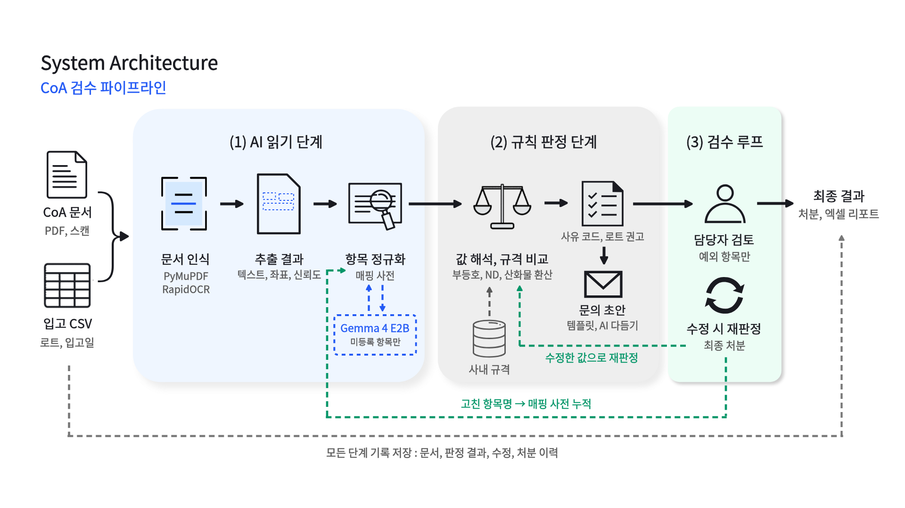

<p align="center">
  
</p>

# 이차전지 원료 CoA 예외 중심 입고 QC 코파일럿
경기대학교 U3 연합 AI 직무 코어 프로젝트 개발 IT

## 1. 주요 기능

대상 원자재는 **탄산리튬(`LI2CO3`)** 과 **수산화리튬(`LIOH`)** 입니다.

**AI 읽기**
- 글자가 있는 PDF는 글자 좌표로, 스캔 PDF, 이미지는 OCR로 읽어 머리글 필드(제품명, 로트, 발행일 등)와 시험 항목 표를 복원합니다.
- CoA가 아닌 문서(규격서, 웹페이지 캡처 등)는 업로드 단계에서 사유와 함께 거절합니다.
- CoA 원문 항목명을 사내 표준 항목명으로 정규화합니다. 사전에 없는 항목에만 LLM(Gemma 4 E2B)을 보조로 쓰고, LLM 서버가 없어도 규칙만으로 동작합니다.
- OCR로 읽은 항목은 신뢰도 상한(0.75)을 두어 모두 담당자 확인을 거치게 합니다.

**규칙 판정** (AI가 아니라 서버 규칙이 판정합니다)
- 값 해석: `< X`, 검출 안 됨(ND), 검출한계, 단위 환산, 산화물 → 원소 환산(K₂O, MgO 등)
- 판정 5종(적합, 부적합, 판정 불가, 누락, 확인 필요)과 사유코드 13종, 사유별 문의 권고
- 교차 규칙: 중금속 총량 → Pb, Cu 판정, Na+K 합산 → 원소별 판정
- 문서 정합성 검사: 로트 불일치, 날짜 충돌, 제품명 vs 접수 원자재, 규격 버전 불일치, 한 문서 내 복수 로트
- 규격 세트 선택, 변경 후 재판정, 로트 간 같은 값 반복 같은 이상 패턴 경고

**검수 루프**
- 예외 항목만 보여 주는 검수 화면: 원문 PDF 대조, 값 수정(사유 기록), 회신값 입력 후 재판정
- 승인, 보류, 승인 취소 처분, 공급사 문의 초안(템플릿 / LLM 다듬기)
- 수정한 항목명은 매핑 사전에 누적되어 다음 문서부터 자동 반영됩니다.

**접수, 운영**
- 단건 업로드, 입고 CSV 기반 일괄 접수, 협력사 직접 입력, 실패, 멈춘 문서 재처리
- 같은 파일 중복 경고, 재발행 CoA 충돌 비교, 방치 문서 표시, 보관, 삭제, 저장 공간 정책
- 계정 권한(ADMIN / USER), 첫 로그인 비밀번호 변경, 로그인 실패 잠금
- 규격 관리(조회, 수정, 되돌리기, 변경 이력)는 관리자 전용

**리포트, 대시보드**
- 문서별, 일괄 엑셀(.xlsx) 리포트, 외부 공유용(가명 처리) 리포트
- 자동 처리율, 사람 확인 항목 비율, 사유코드별 건수, 로트별 이탈 추이, 시스템 처리 시간, 협력사, 항목별 사람 수정률

**개발, 평가 도구**
- 가상 CoA 생성기(양식 A, B, D, 사유코드별 예외, 열화본), 열화 처리 도구
- OCR, VLM, LLM 후보 비교 벤치(`ai/bench`), 추출, 판정 정확도 평가 스크립트(`backend/evaluation`)

## 2. 기술 스택

**Frontend**<br>


**Backend**<br>


**Database**<br>


**AI**<br>


## 3. 시스템 아키텍처

<p align="center">
  
</p>

입고 CoA(PDF, 스캔)와 입고 CSV(로트, 입고일)가 들어오면 세 단계를 거쳐 최종 처분과 엑셀 리포트가 나옵니다.

| 단계 | 하는 일 |
| --- | --- |
| (1) AI 읽기 | 문서 인식(PyMuPDF, RapidOCR) → 추출 결과(텍스트, 좌표, 신뢰도) → 항목 정규화(매핑 사전, 미등록 항목만 Gemma 4 E2B) |
| (2) 규칙 판정 | 값 해석, 규격 비교(부등호, ND, 산화물 환산) → 사유 코드, 로트 권고 → 문의 초안(템플릿, AI 다듬기). 사내 규격 DB를 기준으로 판정 |
| (3) 검수 루프 | 담당자는 예외 항목만 검토. 값을 고치면 수정한 값으로 재판정하고, 고친 항목명은 매핑 사전에 누적 |

모든 단계의 기록(문서, 판정 결과, 수정, 처분 이력)은 DB에 저장됩니다.

## 4. 실행 방법

각 폴더의 README에서 실행 방법을 확인하세요.

- [Backend](backend/README.md)
- [Frontend](frontend/README.md)
- [AI 추출 (coa_ai)](ai/README.md)
- [평가 스크립트, 데모 PDF 만들기](backend/evaluation/README.md)
- [가상 CoA 생성기](ai/generator/README.md)

## 5. 프로젝트 구조

```
coa-spec-checker/
├── README.md
├── docs/
│   └── images/                  # logo.png, architecture.png
├── ai/                          # AI 추출 데이터 생성
│   ├── coa_ai/                  # 추출 패키지 (pip install -e ai)
│   │   ├── pipeline.py          #   전체 흐름: 파일 → 줄 → 유형 분류 → 필드 → 표 → 정규화 → 자체 검증
│   │   ├── pdf_text.py          #   텍스트 PDF 글자 좌표 → 줄, 칸 후보
│   │   ├── ocr.py               #   스캔본, 이미지 OCR (RapidOCR)
│   │   ├── classify.py          #   문서 유형 분류 (CoA / 규격서 / 웹페이지 / 기타)
│   │   ├── fields.py, dates.py  #   머리글 필드, 날짜 표기 변환
│   │   ├── table.py             #   시험 항목 표 복원
│   │   ├── normalize.py         #   항목명 정규화 (vocab.json 사전 + LLM 보조)
│   │   ├── meaning.py           #   결과 칸 의미 분류
│   │   ├── selfcheck.py         #   추출값 자체 검증
│   │   ├── llm.py, inquiry.py   #   LLM 클라이언트, 공급사 문의 초안
│   │   └── __main__.py          #   명령줄 실행 (python -m coa_ai)
│   ├── bench/                   # OCR, VLM, LLM 후보 비교 벤치
│   ├── generator/               # 가상 CoA 생성기 v2 (양식 A, B, D)
│   ├── tools/                   # degrade.py(열화 처리), synth_gt.py
│   ├── tests/                   # 단위 테스트 + 가상 CoA 3장(fixtures)
│   ├── docker-compose.llm.yml   # LLM 서버 (llama.cpp, 포트 8090)
│   └── pyproject.toml
├── backend/                     # API 서버 판정 로직
│   ├── app/
│   │   ├── main.py              #   FastAPI 진입점, 정리 작업 스레드
│   │   ├── api/v1/              #   라우터 (auth, documents, extraction, approval, reports, specs, ...)
│   │   ├── services/            #   업무 로직
│   │   │   └── judgement/       #     판정 엔진: value_parser, item_judge, cross_rules, document_checks, lot_recommend, policy
│   │   ├── pipeline/            #   추출기 연결 (mock / ai), 문서 처리 워커, LLM 클라이언트
│   │   ├── models/, schemas/    #   SQLAlchemy 모델, Pydantic 스키마
│   │   └── core/                #   설정, 보안, 에러, 응답 형식, 로그 안전 처리
│   ├── alembic/versions/        #   DB 마이그레이션
│   ├── seeds/                   #   시드 (계정, 규격 세트, 항목 CSV, 매핑 사전)
│   ├── evaluation/              #   평가 스크립트, 데모 20 시나리오, PDF
│   ├── tools/                   #   입고 CSV 변환기
│   ├── tests/                   #   api/ unit/ 테스트
│   ├── docker-compose.yml       #   PostgreSQL 16
│   └── .env.example
└── frontend/                    # React + Vite + TypeScript
    ├── src/
    │   ├── pages/               #   로그인, 비밀번호 변경
    │   ├── auth/, api/          #   인증 컨텍스트, API 클라이언트
    │   ├── components/layout/   #   사이드바, 헤더 레이아웃
    │   └── features/
    │       ├── upload/          #   업로드, 일괄 접수
    │       ├── review/          #   검수 목록, 상세, 예외 패널, 목업 API
    │       ├── specs/           #   규격 관리, 매핑 사전
    │       ├── dashboard/       #   대시보드, 일괄 접수 처리 현황
    │       └── reports/         #   리포트 다운로드
    ├── dev.html                 #   검수, 규격 화면 단독 미리보기 (목업 전용)
    └── .env.example
```

## 6. 팀원 / 담당 역할

- **[고도영](https://github.com/rhehdud)** / AI 추출
- **[김지원](https://github.com/Jiwvonkim)** / 프론트엔드, 검수와 규격 관리
- **[김태연](https://github.com/taeyeon828)** / 프론트엔드, 업로드와 대시보드
- **[소성훈](https://github.com/sshoon333)** / 데이터, 가상 CoA 생성기 제작
- **[장수민](https://github.com/1ongevitymin)** / 백엔드 총괄, 판정 엔진
- **[홍채령](https://github.com/chaery0ung)** / 백엔드, 평가 스크립트
